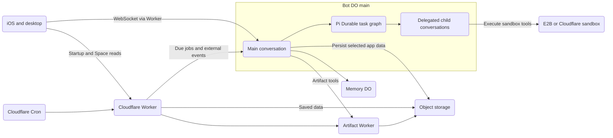

# Architecture

lulu is a self-hosted personal AI assistant for persistent conversations, memory, delegated work, and scheduled tasks. The native clients expose [Panel](panel-and-assets.md), [Chat](chat.md), and [Assets](panel-and-assets.md).

## Repository map

The assistant logic and shared protocol live in [`core/`](../core) and use Pi Durable. [`apps/cf/`](../apps/cf) hosts the core on a Cloudflare Worker and SQLite-backed Durable Objects. [`client/`](../client) contains the iOS and desktop apps and the web MCP administration UI. The iOS target and package retain the PiStack name. Telemetry collection and Grafana dashboards live in [`ops/observability/`](../ops/observability).

## Core APIs

| API | Purpose |
| --- | --- |
| [`/api/bots/main/ws`](../core/src/protocol/wire.ts) | Chat, client state, and card actions. |
| [`/api/bots/main/startup`](../core/src/server/api.ts) | Authenticated Panel and Assets snapshot for initial rendering. |
| [`/api/bots/main/*`](../core/src/server/api.ts) | HTTP access to schedules, memory, artifacts, Spaces, and MCP configuration. |
| [Pi Durable extensions](../core/src/agent/catalog.ts) | Register tools and model context. Persist recoverable state in Docs and use request IDs for replayable side effects. |

## Core entities

| Entity | Owns |
| --- | --- |
| [Bot](../core/src/conversation/bot.ts) | One Durable Object named `main`. Pi Durable SQLite owns the transcript, submissions, task graph, live socket state, delegated runs, and sandbox lifecycle. |
| [Memory](memory.md) | Published memory files, background processing, and request-scoped retrieval. |
| [Bot data](../core/src/conversation/bot-data.ts) | Panel, accepted Assets, Space refresh state, and user schedules live in the object bucket. The Bot keeps transaction-local copies and recovers them from the bucket when its local copies are missing. |
| [Artifact Worker](../apps/cf/src/artifacts.ts) | File operations, version metadata, upload reservations, and quota. Conditional object writes coordinate changes across Worker requests. Pinned file references retain their original object keys. |
| [Cloudflare Cron](execution.md) | Wakes the Worker at registered times. The Worker reads the saved schedules and invokes the existing Bot for due work. |
| [MCP configuration](../core/src/agent/mcp-store.ts) | Encrypted connection configuration in Workers KV. Bot storage holds OAuth authorization. |

The main conversation and delegated child conversations share the Bot's Pi Durable storage. Child conversations have separate message histories and task lifecycles. Sandbox tools execute through the configured sandbox provider and use the workspace associated with the delegating run.

[Deployment](deployment.md) · [Observability](observability.md)
