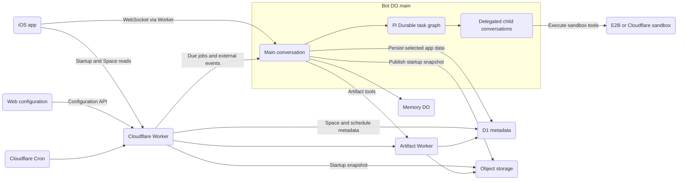

# Architecture

lulu is a self-hosted personal AI assistant for persistent conversations, memory, delegated work, and scheduled tasks. The iOS app exposes [Panel](panel-and-assets.md), [Chat](chat.md), and [Assets](panel-and-assets.md).

## Repository map

| Path | Responsibility |
| --- | --- |
| [`client/ios/`](../client/ios) | Primary app. LuluKit implements the client protocol and session logic. |
| [`client/web/`](../client/web) | Web configuration workspace, currently serving the MCP administration UI. |
| [`core/`](../core) | Assistant logic and protocol. The Web workspace consumes the protocol exports, and the Worker consumes explicit `workerd` entry points. |
| [`apps/cf/`](../apps/cf) | Cloudflare Worker, Durable Object adapters, D1 and static asset bindings. |
| [`ops/observability/`](../ops/observability) | Telemetry collection and Grafana dashboards. |

Run `npm run lint` after `npm run check` to check the TypeScript sources for runtime import cycles. Type-only imports can form cycles. CI builds the Worker and Web assets on Linux and verifies the iOS app on macOS.

## Core APIs

| API | Purpose |
| --- | --- |
| [`/api/bots/main/ws`](../core/src/protocol/wire.ts) | Chat, client state, and card actions. |
| [`/api/bots/main/startup`](../core/src/server/api.ts) | Authenticated Panel and Assets snapshot for initial rendering. |
| [`/api/bots/main/*`](../core/src/server/api.ts) | HTTP access to schedules, memory, artifacts, Spaces, and MCP configuration. |
| [Pi Durable extensions](../core/src/agent/catalog.ts) | Register tools and model context. Persist recoverable state in Docs and use request IDs for replayable side effects. |

## Tool assembly

Feature modules own each tool's schema, instructions, and execution. The [Agent catalog](../core/src/agent/catalog.ts) selects those extensions and assembles the main conversation's instructions. The [MCP extension](../core/src/mcp/extension.ts) adapts remote tools into that same registry.

[Send](../core/src/send/tool.ts) builds one `send_to_user` tool from the catalog's contributions. Panel, scheduling, artifacts, and Spaces each supply a model-facing card schema, guidance, and a function that prepares the delivered card. A feature can also provide guidance by itself. The tool handles request correlation and end-of-turn behavior. Chat reads the prepared card from the tool result and can still read stored cards from earlier versions.

## Core entities

| Entity | Owns |
| --- | --- |
| [Bot](../core/src/conversation/bot.ts) | One Durable Object named `main`. Pi Durable SQLite owns the transcript, submissions, task graph, live socket state, delegated runs, and sandbox lifecycle. |
| [Chat requests](../core/src/conversation/requests.ts) | Admission, deadlines, delivery retries and receipts. The chat module owns the persisted request state. |
| [Panel and Assets](../core/src/panel.ts) | Acceptance of offered cards, Checklist changes and Asset order. |
| [Memory](memory.md) | Published memory files, background processing, and request-scoped retrieval. |
| [Bot data](../core/src/conversation/bot-data.ts) | D1 stores Panel, accepted Asset references, Space refresh metadata, and schedules. The Bot keeps transaction-local copies and can restore them from D1. The bucket holds the derived startup snapshot. |
| [Artifact Worker](../apps/cf/src/artifacts.ts) | File bodies in the object bucket. D1 transactions own version metadata, upload reservations, request IDs, and quota. Pinned file references retain their original object keys. |
| [Cloudflare Cron](execution.md) | Wakes the Worker at registered times. The Worker reads the saved schedules and invokes the existing Bot for due work. |
| [MCP configuration](../core/src/mcp/store.ts) | Encrypted connection configuration in Workers KV. Bot storage holds OAuth authorization. |

The main conversation and delegated child conversations share the Bot's Pi Durable storage. Child conversations have separate message histories and task lifecycles. Sandbox tools execute through the configured sandbox provider and use the workspace associated with the delegating run.

[Deployment](deployment.md) · [Observability](observability.md)
